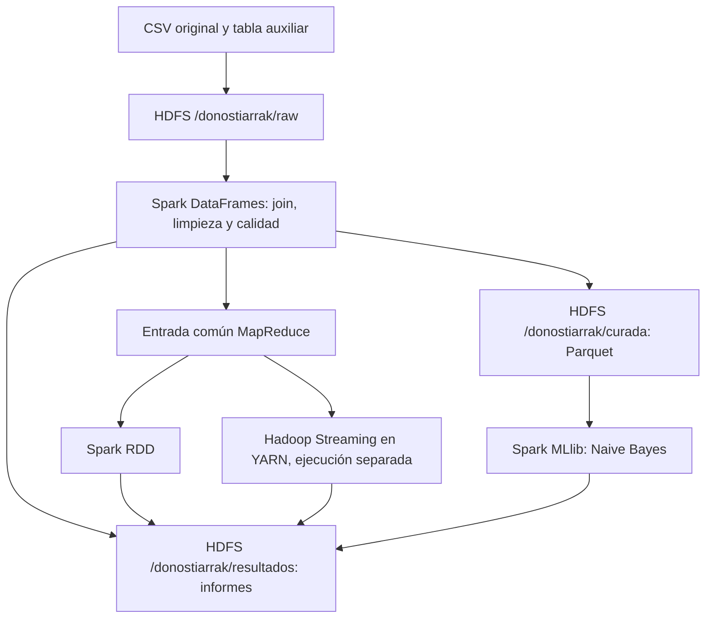

# DonostIArrak — Arquitectura Big Data local

Proyecto de **Big Data & Cloud Computing (curso 2026–2027)** para procesar y analizar un conjunto de correos municipales. El entorno utiliza **Docker Compose, HDFS, YARN, Hadoop Streaming, Apache Spark y Jupyter/PySpark**.

La aplicación integra la ingesta y limpieza de datos, almacenamiento en Parquet, agregaciones con Spark DataFrames y RDDs, comprobaciones de calidad y una línea base de clasificación con Spark MLlib. **Hadoop Streaming se ejecuta por separado**; no forma parte del ejecutor `run_pipeline.py`.

## Inicio rápido: abrir JupyterLab

Esta guía está pensada para alguien que descarga el repositorio por primera vez en **Windows con PowerShell**. La documentación técnica detallada continúa a partir de la sección 1.

1. **Clonar el repositorio** (omitir este paso si ya se tiene una copia):

   ```powershell
   git clone https://github.com/ikerelias/DonostIArrak.git
   cd DonostIArrak
   ```

   Mientras los cambios no estén integrados en `main`, seleccionar la rama que contiene el pipeline actualizado:

   ```powershell
   git switch aitor-prueba1
   ```

   Tras fusionar el Pull Request en `main`, bastará con clonar la rama predeterminada.

2. **Colocar los archivos de entrada** en `notebooks/data/` con los nombres `dataset.csv` y `categorias_auxiliar.csv`. Los proporciona la fuente autorizada y **no se descargan desde GitHub**:

   ```powershell
   New-Item -ItemType Directory -Force .\notebooks\data
   ```

3. **Arrancar Docker Desktop** y, desde la raíz del repositorio, iniciar todos los servicios:

   ```powershell
   docker compose up -d --build
   docker compose ps
   ```

   Esperar a que arranquen Jupyter, Spark y HDFS. La primera construcción puede tardar varios minutos.

4. **Abrir JupyterLab** en el navegador: **<http://localhost:8888/lab>**. Si solicita un token, obtener el enlace de acceso en los registros:

   ```powershell
   docker logs jupyter-pyspark
   ```

5. **Abrir `prueba1.ipynb`** desde el explorador de archivos de JupyterLab, seleccionar el kernel de Python y ejecutar **celda a celda, en orden** (`Shift+Enter`). Antes de ejecutar las celdas que leen HDFS, realizar la carga inicial descrita en la [sección 5](#5-ingesta-inicial-en-hdfs), si todavía no está hecha.

> **Importante:** abrir JupyterLab está documentado y probado en el entorno de desarrollo, pero **no se ha validado un `Run All` completo del notebook de 79 celdas**. Varias celdas escriben resultados con `overwrite` y las etapas de entrenamiento pueden requerir dependencias o recursos adicionales. Para una comprobación automatizada y aislada, utilizar el [smoke test del pipeline](#6-ejecutar-el-pipeline-spark).

## 1. Requisitos

- Git y Docker Desktop con Docker Compose.
- **Al menos 8 GB de RAM asignados a Docker**, y suficiente memoria adicional para el sistema operativo. Ajustar los recursos de Spark a la máquina disponible.
- Espacio en disco para el CSV original, las copias en HDFS con replicación y los resultados; se recomienda reservar **al menos tres veces el tamaño del dataset, más 10 GB**, siguiendo el enunciado.
- Puertos locales libres: `8888`, `9870`, `9000`, `8080`, `8081`, `7077` y `8088`.
- Archivos `dataset.csv` y `categorias_auxiliar.csv` obtenidos de la fuente autorizada. **No están incluidos en Git.**

> **Pendiente de documentar antes de la entrega:** fuente pública de descarga, licencia original y script para obtener el dataset de forma reproducible. Actualmente los CSV se distribuyen por separado dentro del equipo. El profesor requiere esa información y un script de descarga. También debe comprobarse el tamaño exigido al dataset original (5–20 GB).

## 2. Arquitectura

| Servicio | Función |
| --- | --- |
| `namenode` y `datanode1`–`datanode3` | HDFS con factor de replicación configurado a 3 |
| `resourcemanager` y `nodemanager1` | Ejecución de trabajos Hadoop Streaming mediante YARN |
| `historyserver` | Infraestructura de historial Hadoop |
| `spark-master` y `spark-worker` | Procesamiento distribuido Spark |
| `jupyter-pyspark` | Desarrollo y ejecución del notebook y del pipeline |



La configuración del procesamiento está en `notebooks/config.json` y `notebooks/pipeline.json`; los servicios Hadoop se configuran mediante `hadoop.env` y `docker-compose.yml`.

## 3. Obtener el código y colocar los datos

Desde **PowerShell**:

```powershell
git clone https://github.com/ikerelias/DonostIArrak.git
cd DonostIArrak
```

La versión de integración en desarrollo está en la rama `aitor-prueba1`. Hasta que se fusione en `main`, usar:

```powershell
git switch aitor-prueba1
```

Crear la carpeta de datos:

```powershell
New-Item -ItemType Directory -Force .\notebooks\data
```

Colocar los dos archivos, con estos nombres exactos:

```text
DonostIArrak/
├── notebooks/
│   ├── data/
│   │   ├── dataset.csv
│   │   └── categorias_auxiliar.csv
│   ├── config.json
│   ├── pipeline.json
│   ├── run_pipeline.py
│   └── prueba1.ipynb
├── scripts/hadoop_streaming/
│   ├── mapper.py
│   └── reducer.py
├── docker-compose.yml
├── Dockerfile.jupyter
├── Dockerfile.nodemanager
└── hadoop.env
```

Los CSV y los resultados grandes se excluyen de Git mediante `.gitignore`.

## 4. Iniciar Docker

Desde la raíz del repositorio, ejecutar:

```powershell
docker compose up --build
```

Este único comando construye las imágenes que lo requieren y arranca los servicios definidos en `docker-compose.yml`. La primera construcción puede tardar varios minutos. Dejar abierta esta terminal o, si se prefiere ejecutar en segundo plano, usar `docker compose up -d --build`.

Comprobar el estado de los servicios desde otra terminal:

```powershell
docker compose ps
docker exec resourcemanager yarn node -list
docker exec namenode hdfs dfsadmin -report
```

El informe de HDFS debería identificar los DataNodes disponibles; YARN debería registrar al menos un NodeManager en estado `RUNNING`. Si se han levantado otros proyectos Docker con los mismos nombres de contenedor, resolver primero el conflicto sin eliminar sus volúmenes. En una instalación existente que se haya creado con `-p donostiarrak-nuevo`, mantener ese nombre de proyecto para las operaciones de Compose (por ejemplo, `docker compose -p donostiarrak-nuevo ps`).

### Interfaces

| Interfaz | URL |
| --- | --- |
| JupyterLab | <http://localhost:8888> |
| HDFS NameNode | <http://localhost:9870> |
| Spark Master | <http://localhost:8080> |
| Spark Worker | <http://localhost:8081> |
| YARN ResourceManager | <http://localhost:8088> |

### Abrir y utilizar `prueba1.ipynb` en JupyterLab

1. Con los contenedores arrancados, abrir **<http://localhost:8888/lab>**. También se puede acceder desde <http://localhost:8888>, que normalmente redirige a la interfaz de Jupyter.
2. Si se solicita autenticación, copiar el **token** o la URL con token mostrada por:

   ```powershell
   docker logs jupyter-pyspark
   ```

   Si los contenedores se han iniciado desde este directorio con Compose, también se pueden consultar sus registros con `docker compose logs jupyter-pyspark`. No copiar tokens a GitHub ni al README.
3. En el explorador de archivos de JupyterLab, abrir **`prueba1.ipynb`**. El directorio local `notebooks/` está montado dentro del contenedor como `/home/jovyan/work`, por lo que el notebook se muestra directamente en la carpeta inicial.
4. Seleccionar el kernel **Python 3** disponible y ejecutar las celdas en orden con `Shift+Enter`. Antes de las primeras lecturas del dataset desde HDFS, comprobar que se han cargado los CSV de la [sección 5](#5-ingesta-inicial-en-hdfs).
5. Si alguna celda falla, revisar el error y las variables de las celdas anteriores antes de continuar. **No usar `Run All` sobre los 15 millones de correos como primera prueba**: el notebook integrado aún no se ha validado por completo y algunas operaciones utilizan `.mode("overwrite")`.

**Diferencia entre los dos modos de trabajo:** `prueba1.ipynb` permite examinar y ejecutar las etapas interactivamente; `run_pipeline.py` automatiza la ingesta, calidad, Parquet, agregaciones y MLlib. El comando `--smoke-test` de la sección 6 es la opción **ya validada** para comprobar el pipeline sobre 20.000 registros y con salidas aisladas. **No equivale a ejecutar todas las celdas del notebook.**

## 5. Ingesta inicial en HDFS

El pipeline completo (`--run`) realiza la ingesta automáticamente, pero **sobrescribe los CSV de `/donostiarrak/raw` y las salidas configuradas**. Si se desea hacer primero una prueba aislada sin ejecutar el pipeline completo, cargar los archivos originales una sola vez:

```powershell
docker cp .\notebooks\data\dataset.csv namenode:/tmp/dataset.csv
docker cp .\notebooks\data\categorias_auxiliar.csv namenode:/tmp/categorias_auxiliar.csv
docker exec namenode hdfs dfs -mkdir -p /donostiarrak/raw
docker exec namenode hdfs dfs -put /tmp/dataset.csv /donostiarrak/raw/
docker exec namenode hdfs dfs -put /tmp/categorias_auxiliar.csv /donostiarrak/raw/
docker exec namenode hdfs dfs -ls /donostiarrak/raw
```

**No se usa `-f`**: si un destino existe, `hdfs dfs -put` fallará en vez de reemplazarlo. No repetir esta carga si los CSV originales ya están en HDFS. La copia temporal bajo `/tmp` ocupa espacio adicional dentro del contenedor NameNode.

## 6. Ejecutar el pipeline Spark

Los tres comandos siguientes se ejecutan desde PowerShell, en la raíz del repositorio. El directorio de trabajo dentro del contenedor Jupyter es `/home/jovyan/work`.

**Comprobación de configuración y archivos (solo lectura):**

```powershell
docker exec -w /home/jovyan/work jupyter-pyspark python run_pipeline.py --check
```

**Prueba de integración sobre un máximo de 20.000 correos:** requiere que los CSV ya estén en HDFS `/donostiarrak/raw`.

```powershell
docker exec -w /home/jovyan/work jupyter-pyspark /usr/local/spark/bin/spark-submit run_pipeline.py --smoke-test
```

Esta prueba **no modifica la zona `raw`** ni las salidas oficiales. Escribe, y puede sobrescribir en sucesivas pruebas, únicamente las rutas bajo:

```text
/donostiarrak/resultados/prueba_integracion/
```

Ejecutar dos veces para comprobar que la reejecución finaliza sin errores y mantiene los recuentos esperados.

**Ejecución completa del dataset:**

```powershell
docker exec -w /home/jovyan/work jupyter-pyspark /usr/local/spark/bin/spark-submit run_pipeline.py --run
```

> **Precaución:** `--run` vuelve a copiar los CSV a `raw` **con sobrescritura** y reemplaza las salidas oficiales (Parquet, calidad, agregaciones, RDD y métricas). Ejecutarlo solamente cuando se quiera regenerar todo el procesamiento y se haya verificado que los archivos locales son los correctos. Puede consumir recursos significativos y no ha quedado validado en este entorno con el dataset completo.

El ejecutor incluye validación de `email_id`, texto, categoría y `split`; separa registros válidos y cuarentena; genera informes y un modelo Naive Bayes de Spark MLlib con métricas de accuracy y F1 ponderado. El notebook `notebooks/prueba1.ipynb` permite inspeccionar y extender estas etapas de manera interactiva.

## 7. Hadoop Streaming y comparación con Spark RDD

El pipeline Spark genera la entrada común MapReduce en HDFS. Para validar Hadoop Streaming con los **20.000 correos de la prueba aislada**:

1. Copiar los scripts versionados al contenedor NameNode:

   ```powershell
   docker cp .\scripts\hadoop_streaming\mapper.py namenode:/tmp/mapper.py
   docker cp .\scripts\hadoop_streaming\reducer.py namenode:/tmp/reducer.py
   ```

2. Ejecutar desde PowerShell, utilizando una ruta de salida diferente en cada ejecución:

   ```powershell
   $salida = '/donostiarrak/resultados/prueba_integracion/hadoop_streaming_' + (Get-Date -Format 'yyyyMMdd_HHmmss')

   docker exec namenode hadoop jar /opt/hadoop-3.2.1/share/hadoop/tools/lib/hadoop-streaming-3.2.1.jar `
       -D "mapreduce.framework.name=yarn" `
       -D "yarn.resourcemanager.hostname=resourcemanager" `
       -D "yarn.app.mapreduce.am.env=HADOOP_MAPRED_HOME=/opt/hadoop-3.2.1" `
       -D "mapreduce.map.env=HADOOP_MAPRED_HOME=/opt/hadoop-3.2.1" `
       -D "mapreduce.reduce.env=HADOOP_MAPRED_HOME=/opt/hadoop-3.2.1" `
       -D "mapreduce.job.reduces=2" `
       -files file:///tmp/mapper.py,file:///tmp/reducer.py `
       -input /donostiarrak/resultados/prueba_integracion/mr_input `
       -output $salida `
       -mapper "python3 mapper.py" `
       -reducer "python3 reducer.py"
   ```

3. Consultar las salidas:

   ```powershell
   docker exec namenode hdfs dfs -ls $salida
   docker exec namenode hdfs dfs -cat "$salida/part-*"
   ```

`mapper.py` genera pares clave/valor y `reducer.py` suma los correos por combinación **(zona, familia_escenario)**. Los scripts son compatibles con Python 3.5, disponible en la imagen `Dockerfile.nodemanager`.

El cálculo equivalente con **Spark RDD** se realiza en el propio pipeline y guarda su salida en `prueba_integracion/rdd`. Para el informe, comparar ambos resultados y medir el tiempo de cada implementación bajo condiciones equivalentes; no considerar los tiempos de arranque de los servicios como tiempo de cálculo.

## 8. Evidencias de HDFS y resultados

**Bloques y replicación:**

```powershell
docker exec namenode hdfs fsck /donostiarrak/raw/dataset.csv -files -blocks -locations
```

**Listar resultados de la prueba:**

```powershell
docker exec namenode hdfs dfs -ls /donostiarrak/resultados/prueba_integracion
```

El informe final del proyecto también debe recoger las consultas analíticas Spark, una función de ventana, `explain()`, las etapas y shuffles en la Spark UI, una optimización con medidas antes/después, la comparación CSV/Parquet y el desafío seleccionado de calidad de datos.

## 9. Detener y volver a iniciar

Detener sin borrar datos:

```powershell
docker compose stop
```

Reiniciar:

```powershell
docker compose start
```

**No utilizar `docker compose down -v`** si se desean conservar los volúmenes de HDFS. Las carpetas de datos de HDFS están almacenadas en volúmenes Docker persistentes.

## 10. Problemas habituales

- **Jupyter pide un token:** consultarlo con `docker logs jupyter-pyspark` y abrir la URL que aparece en los registros. No publicar el token.
- **Jupyter abre, pero falla la lectura de CSV:** comprobar que los CSV locales están en `notebooks/data/` y que los archivos necesarios existen en `/donostiarrak/raw` de HDFS (sección 5).
- **El notebook falla con una librería ausente:** comprobar las dependencias instaladas en el kernel seleccionado; el éxito del `--smoke-test` no garantiza todas las dependencias de las celdas interactivas.
- **Un puerto ya está en uso:** cerrar el servicio que lo ocupa o ajustar el mapeo de puertos; revisar `docker compose ps`.
- **Nombre de contenedor en conflicto:** suele deberse a otro proyecto Compose con los mismos `container_name`; inspeccionarlo antes de eliminar o recrear servicios.
- **HDFS Safe Mode:** comprobar primero `docker exec namenode hdfs dfsadmin -safemode get` y esperar a la salida automática. No forzar la desactivación si existen bloques ausentes o DataNodes no disponibles.
- **`ModuleNotFoundError: pyspark` al ejecutar el pipeline:** usar `/usr/local/spark/bin/spark-submit` para `--run` y `--smoke-test`; `python` directo solo está documentado aquí para `--check`.
- **La ruta de Hadoop Streaming ya existe:** utilizar una ruta nueva; Hadoop no sobrescribe directorios de salida existentes.

## 11. Alcance y pendientes de reproducibilidad

La reconstrucción de `nodemanager1` y una prueba Hadoop Streaming/YARN con 20.000 correos finalizaron correctamente en el entorno del equipo; también se ejecutó dos veces el pipeline Spark de prueba. **Esto no sustituye una validación de instalación completamente limpia, un `Run All` del notebook integrado ni una ejecución final sobre los 15 millones de correos.**

Antes de entregar se debe añadir/verificar: el mecanismo de descarga y la licencia del dataset; las evidencias de los apartados A–F del enunciado; las mediciones de rendimiento sobre el dataset completo; y la compatibilidad final de los cambios al integrarse con `main`.
